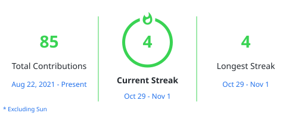

  <picture>
    <source media="(prefers-color-scheme: light)" srcset="https://capsule-render.vercel.app/api?type=waving&height=100&color=00000011&section=header&reversal=false&text=TEMPLATEDEV&textBg=false&fontColor=000000&fontSize=64&fontAlign=50&fontAlignY=55&animation=blink&rotate=0&strokeWidth=0&descSize=20&descAlign=50&descAlignY=60" />
    <source media="(prefers-color-scheme: dark)" srcset="https://capsule-render.vercel.app/api?type=waving&height=100&color=ffffff11&section=header&reversal=false&text=TEMPLATEDEV&textBg=false&fontColor=ffffff&fontSize=64&fontAlign=50&fontAlignY=55&animation=blink&rotate=0&strokeWidth=0&descSize=20&descAlign=50&descAlignY=60" />
    
  </picture>

  <picture>
    <source media="(prefers-color-scheme: light)" srcset="https://readme-typing-svg.demolab.com?font=Poppins&size=12&duration=2000&pause=2000&color=6D28D9&center=true&vCenter=true&width=435&lines=Curious+by+nature.+;Versatile+by+choice.+;Always+building+something." />
    <source media="(prefers-color-scheme: dark)" srcset="https://readme-typing-svg.demolab.com?font=Poppins&size=12&duration=2000&pause=2000&color=1ADF66&center=true&vCenter=true&width=435&lines=Curious+by+nature.+;Versatile+by+choice.+;Always+building+something." />
    
  </picture>

  <picture>
    <source media="(prefers-color-scheme: light)" srcset="https://img.shields.io/github/followers/templatedev?style=for-the-badge&logo=github&label=Followers&color=6D28D9&labelColor=374151" />
    <source media="(prefers-color-scheme: dark)" srcset="https://img.shields.io/github/followers/templatedev?style=for-the-badge&logo=github&label=Followers&color=8B5CF6&labelColor=161B22" />
    
  </picture>
  <picture>
    <source media="(prefers-color-scheme: light)" srcset="https://img.shields.io/badge/dynamic/json?url=https%3A%2F%2Fapi.github.com%2Fusers%2Ftemplatedev&query=%24.public_repos&label=Repositories&logo=github&style=for-the-badge&color=1D4ED8&labelColor=374151" />
    <source media="(prefers-color-scheme: dark)" srcset="https://img.shields.io/badge/dynamic/json?url=https%3A%2F%2Fapi.github.com%2Fusers%2Ftemplatedev&query=%24.public_repos&label=Repositories&logo=github&style=for-the-badge&color=3B82F6&labelColor=161B22" />
    
  </picture>
  <picture>
    <source media="(prefers-color-scheme: light)" srcset="https://img.shields.io/github/stars/templatedev?affiliations=OWNER&style=for-the-badge&logo=github&label=Stars&color=0E7490&labelColor=374151" />
    <source media="(prefers-color-scheme: dark)" srcset="https://img.shields.io/github/stars/templatedev?affiliations=OWNER&style=for-the-badge&logo=github&label=Stars&color=06B6D4&labelColor=161B22" />
    
  </picture>

  <picture>
    <source media="(prefers-color-scheme: light)" srcset="https://github.com/TemplateDev/TemplateDev/blob/output/github-contribution-grid-snake.svg" />
    <source media="(prefers-color-scheme: dark)" srcset="https://github.com/TemplateDev/TemplateDev/blob/output/github-contribution-grid-snake-dark.svg" />
    
  </picture>

# About Me

- 💡 Often inspired by interesting ideas, projects, and things I stumble across.
- 🔬 I enjoy experimenting with new libraries, technologies, and APIs.
- 🛠️ I learn by building, prototyping, and figuring things out along the way.
- 🌐 Particularly drawn to web development and its ever-growing UI ecosystem.
- 🧩 I have a habit of starting projects just to see where an idea takes me.

> [!NOTE]
> Not everything I build becomes a finished project, and that's part of the fun.
>
> I mean, I'm professionally discarding **+100 drafts**. Clearly, I'm learning!

---

<picture>
  <source media="(prefers-color-scheme: light)" srcset="https://capsule-render.vercel.app/api?type=shark&height=50&color=e01d1d11&section=header&text=Primary+Toolkit&fontColor=000000&fontSize=30&fontAlign=50&fontAlignY=55&animation=blink&descSize=20&descAlign=50&descAlignY=60" />
  <source media="(prefers-color-scheme: dark)" srcset="https://capsule-render.vercel.app/api?type=shark&height=50&color=e01d1d11&section=header&text=Primary+Toolkit&fontColor=ffffff&fontSize=30&fontAlign=50&fontAlignY=55&animation=blink&descSize=20&descAlign=50&descAlignY=60" />
  
</picture>

  

 

<picture>
  <source media="(prefers-color-scheme: light)" srcset="https://capsule-render.vercel.app/api?type=shark&height=50&color=1de08c11&section=header&text=Frameworks+%2F+Libraries&fontColor=000000&fontSize=30&fontAlign=50&fontAlignY=50&animation=blink&descSize=20&descAlign=50&descAlignY=60" />
  <source media="(prefers-color-scheme: dark)" srcset="https://capsule-render.vercel.app/api?type=shark&height=50&color=1de08c11&section=header&text=Frameworks+%2F+Libraries&fontColor=ffffff&fontSize=30&fontAlign=50&fontAlignY=50&animation=blink&descSize=20&descAlign=50&descAlignY=60" />
  
</picture>

  

 

<picture>
  <source media="(prefers-color-scheme: light)" srcset="https://capsule-render.vercel.app/api?type=shark&height=50&color=1d4be011&section=header&text=Tools+%2F+Platforms&fontColor=000000&fontSize=30&fontAlign=50&fontAlignY=50&animation=blink&descSize=20&descAlign=50&descAlignY=60" />
  <source media="(prefers-color-scheme: dark)" srcset="https://capsule-render.vercel.app/api?type=shark&height=50&color=1d4be011&section=header&text=Tools+%2F+Platforms&fontColor=ffffff&fontSize=30&fontAlign=50&fontAlignY=50&animation=blink&descSize=20&descAlign=50&descAlignY=60" />
  
</picture>

  

 

<h1 align="center">GitHub Stats</h1>

<picture>
  <source media="(prefers-color-scheme: light)" srcset="https://github.com/TemplateDev/TemplateDev/blob/main/profile/streak-light.svg" />
  <source media="(prefers-color-scheme: dark)" srcset="https://github.com/TemplateDev/TemplateDev/blob/main/profile/streak-dark.svg" />
  
</picture>

  <picture>
    <source media="(prefers-color-scheme: light)" srcset="https://ghstats.dev/api/card?username=templatedev&hide_border=true&hide=streak%2Cgrade%2Cfollowers%2Ccontributions&bg=ffffff&text=24292f&title_color=0969da&icon_color=0969da" />
    <source media="(prefers-color-scheme: dark)" srcset="https://ghstats.dev/api/card?username=templatedev&hide_border=true&hide=streak%2Cgrade%2Cfollowers%2Ccontributions&bg=0d1117&text=e6edf3&title_color=58a6ff&icon_color=58a6ff" />
    
  </picture>
  <picture>
    <source media="(prefers-color-scheme: light)" srcset="https://ghstats.dev/api/langs?username=templatedev&hide_border=true&layout=vertical_list&bg=ffffff&text=24292f&title_color=0969da&icon_color=0969da" />
    <source media="(prefers-color-scheme: dark)" srcset="https://ghstats.dev/api/langs?username=templatedev&hide_border=true&layout=vertical_list&bg=0d1117&text=e6edf3&title_color=58a6ff&icon_color=58a6ff" />
    
  </picture>

  

<picture>
  <source media="(prefers-color-scheme: light)" srcset="https://capsule-render.vercel.app/api?type=waving&height=100&color=00000011&section=footer&text=Thanks+for+taking+a+look+around%21+%F0%9F%91%8B&fontColor=000000&fontSize=36&fontAlign=50&fontAlignY=21&desc=While+you%27re+at+it%2C+check+out+my+projects%21&descSize=24&descAlign=40&descAlignY=55" />
  <source media="(prefers-color-scheme: dark)" srcset="https://capsule-render.vercel.app/api?type=waving&height=100&color=ffffff11&section=footer&text=Thanks+for+taking+a+look+around%21+%F0%9F%91%8B&fontColor=FFFFFF&fontSize=36&fontAlign=50&fontAlignY=21&desc=While+you%27re+at+it%2C+check+out+my+projects%21&descSize=24&descAlign=40&descAlignY=55" />
  
</picture>
